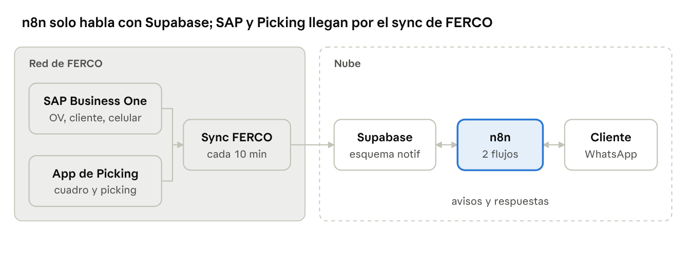

# Instructivo Supabase — Notificaciones WhatsApp a clientes

17 de noviembre de 2026 · Pedro Morales

## Resumen

n8n solo se conecta a una base de datos en Supabase (proyecto **SAC_FERCO**, esquema `notif`). No se conecta a SAP, a SQL Server ni al app de Picking: un proceso de FERCO copia cada 10 minutos lo necesario de esos sistemas a Supabase.



Lo que queda dentro de la red de FERCO nunca se expone; n8n (resaltado) es la única pieza que construye el equipo de Elena y Keny.

Lo que le toca a n8n son dos flujos:

1. **Enviar avisos**: tomar los avisos pendientes, mandar el WhatsApp con la plantilla que corresponde y registrar si se envió.
2. **Recibir respuestas**: cuando el cliente contesta, identificar el pedido y guardar su respuesta (confirma, reprograma o rechaza).

Hoy entran los pedidos de venta (OV) del almacén **138 (Guatemala)**. El país viene en cada fila, así que El Salvador y Honduras se suman después sin cambiar los flujos.

## Conexión

En n8n se crea una credencial **Postgres** (no la de Supabase) con estos datos. No hay que abrir puertos ni montar VPN: n8n Cloud llega por internet con SSL.

| Campo | Valor |
| --- | --- |
| Host | El del *Session pooler* de SAC_FERCO (Supabase → Project Settings → Database → Connection string → Session pooler). Región `ca-central-1` |
| Puerto | `5432` |
| Base de datos | `postgres` |
| Usuario | `notif_n8n.fhefwggpiumjtcnqixsb` |
| Contraseña | Se entrega aparte |
| SSL | `require` |

El usuario es de solo lectura: puede leer dos vistas y el catálogo, y ejecutar las cuatro funciones de los flujos. No puede leer ni modificar las tablas directamente. Es Postgres 17.

## Catálogo de estatus

Cada pedido avanza en este orden y nunca retrocede. Los que dicen "sí" en *WhatsApp* generan un aviso; la columna *Plantilla* es el nombre que debe tener la plantilla aprobada en WhatsApp Business. Está también en la tabla `notif.estado_catalogo`.

| Estatus | Significado | De dónde sale | WhatsApp | Plantilla |
| --- | --- | --- | --- | --- |
| `RECIBIDO` | Pedido en preparación | SAP Business One: campo de usuario `U_Estado2 = '03'` de la OV | sí | `pedido_recibido` |
| `CONFIRMADO_CLIENTE` | El cliente confirmó por WhatsApp | n8n (respuesta del cliente) | no | — |
| `PLANIFICADO` | Asignado a un cuadro de ruta | App de Picking | sí | `pedido_planificado` |
| `PICKING_INICIADO` | Empezó la preparación en bodega | App de Picking (que lee LISA) | sí | `picking_iniciado` |
| `PICKING_COMPLETADO` | Terminó la preparación en bodega | App de Picking (que lee LISA) | sí | `picking_completado` |
| `DESPACHADO` | Salió con camión asignado | App de Picking + placa del cuadro en SAP | sí | `pedido_despachado` |
| `CANCELADO` | OV cancelada en SAP | SAP Business One | no | — |

"En ruta" equivale hoy a `DESPACHADO`. **"Entregado" todavía no tiene fuente**; queda pendiente definir de dónde sale.

## Vista de pedidos activos

Para consultas, tableros o para armar el texto de un mensaje está `notif.v_pedidos_activos`: una fila por pedido, solo los que no se han despachado ni cancelado y los que cerraron en los últimos 7 días. Hoy tiene unos 1,200 pedidos.

```sql
select * from notif.v_pedidos_activos where celular = '+50255551234';
```

| Columna | Qué es |
| --- | --- |
| `pais`, `numero_pedido` | País (GT, SV, HN) y número de la OV en SAP |
| `cliente_nombre`, `celular` | Cliente y celular en formato internacional (`+502...`) |
| `notificable` | `false` si no hay un celular móvil válido; a esos no se les escribe |
| `vendedor_nombre`, `vendedor_email` | Vendedor de la OV |
| `direccion`, `fecha_entrega` | Dirección y fecha de entrega de SAP |
| `fecha_entrega_cliente` | La fecha que pidió el cliente, si reprogramó |
| `estado`, `estado_descripcion` | Estatus actual (ver catálogo) |
| `fecha_ultimo_cambio` | Fecha y hora del último cambio de estatus |
| `confirmacion` | Respuesta del cliente: `pendiente`, `confirmado`, `reprogramar` o `rechazado` |
| `cuadro_ruta`, `placa` | Cuadro de ruta y camión, cuando existen |
| `fecha_recibido` … `fecha_cancelado` | Historial: fecha y hora en que el pedido llegó a cada estatus |
| `almacen` | Almacén SAP que despacha (hoy `138`) |

Las fechas vienen con zona horaria. "Recibido" y "planificado" son la hora en que el sistema lo detectó (hasta unos 10 minutos después del hecho).

## Detalle del pedido y condiciones de entrega

Desde el 17 de noviembre de 2026, cada pedido trae también sus artículos y las condiciones de entrega de la OV en SAP. Vienen en la vista `notif.v_pedidos_activos` y en cada aviso de `tomar_avisos`, como columnas al final.

| Columna | Qué es | Campo en SAP | Viene lleno en |
| --- | --- | --- | --- |
| `detalle` | Artículos del almacén que despacha, sin precios (ver ejemplo abajo) | Líneas de la OV | todas las OV abiertas |
| `instrucciones_entrega` | Instrucciones de entrega | `U_FE_InstEntrega` | 16 % |
| `comentarios` | Comentarios de la OV escritos por ventas | `Comments` | 91 % |
| `ton_max` | Toneladas máximas del camión que puede ingresar | `U_FE_TonMax` | 9 % |
| `requiere_montacarga` | Requiere montacarga (`true` / `false`) | `U_FE_Montacarga` | 77 % |
| `requiere_cuadrilla` | Requiere cuadrilla (`true` / `false`) | `U_FE_Cuadrilla` | 77 % |
| `mapa_url` | Enlace de Google Maps del punto de entrega | `U_Latitud`, `U_Longitud` | 9 % |

El contacto que recibe sigue siendo `celular` (`U_Celular`). En SAP no existe un campo para su nombre; cuando ventas lo anota, viene dentro de `comentarios`.

Ejemplo de `detalle`, una lista con una entrada por artículo:

```json
[
  { "linea": 0, "codigo": "060466", "cantidad": 1, "unidad": "CAJA",
    "descripcion": "MAGNET SMOKE MEMSMO04N MATE RECT. 60 X 60" },
  { "linea": 1, "codigo": "001787", "cantidad": 150, "unidad": "ST",
    "descripcion": "CEMIX PSP GRIS SACO 20KG 33811" }
]
```

**Cuidado con `comentarios`**: es texto libre de ventas y puede traer notas internas. Sirve para entender las condiciones (horario, llamar antes, dónde se descarga), pero no debe pegarse tal cual en el mensaje al cliente sin revisarlo.

## Flujo 1 — Envío de avisos

n8n pide los avisos pendientes, manda un WhatsApp por cada uno y reporta el resultado. Se recomienda correrlo cada 2 a 5 minutos.

1. **Disparador**: *Schedule Trigger* cada 2–5 minutos.
2. **Tomar avisos** (nodo Postgres, *Execute Query*):

    ```sql
    select * from notif.tomar_avisos(50);
    ```

    Devuelve hasta 50 avisos y los aparta (quedan en `enviando`). Si dos ejecuciones se cruzan, cada una recibe avisos distintos: no hay mensajes repetidos.

3. **Enviar el WhatsApp** por cada fila, con la plantilla de la columna `plantilla_wa` al número `celular_e164`.
4. **Reportar el resultado** (nodo Postgres) por cada fila:

    ```sql
    -- si se envió
    select notif.marcar_envio({{ $json.id }}, 'enviado', '{{ id del mensaje que devuelve WhatsApp }}');
    -- si falló
    select notif.marcar_envio({{ $json.id }}, 'error', null, '{{ mensaje de error }}');
    ```

    Guardar el id del mensaje de WhatsApp es importante: con él se reconoce después a qué pedido responde el cliente.

Columnas que trae cada aviso, para llenar la plantilla:

| Columna | Uso |
| --- | --- |
| `id` | Id del aviso; se usa en `marcar_envio` |
| `evento`, `plantilla_wa` | Qué pasó y qué plantilla usar |
| `pais`, `doc_num` | País y número de pedido |
| `cliente_nombre`, `celular_e164` | A quién y a qué número |
| `direccion`, `fecha_entrega` | Dirección y fecha (si el cliente reprogramó, ya viene su fecha) |
| `vendedor_nombre`, `vendedor_email` | Vendedor, por si la plantilla lo menciona |
| `cuadro`, `placa`, `centro` | Cuadro de ruta, camión y almacén, cuando existen |
| `ocurrido_en` | Cuándo pasó |

Si un aviso se queda en `enviando` más de 15 minutos (n8n falló a media ejecución), vuelve a estar disponible solo. Un aviso marcado `error` no se reintenta.

## Flujo 2 — Respuestas del cliente

Cuando el cliente contesta, n8n identifica el pedido y guarda la respuesta en Supabase.

1. **Disparador**: el webhook de WhatsApp con el mensaje entrante.
2. **Identificar el pedido** (nodo Postgres):
    - Si el cliente respondió citando nuestro mensaje (trae el id del mensaje original):

        ```sql
        select * from notif.pedidos_por_respuesta('{{ id del mensaje citado }}', null);
        ```

    - Si no lo citó, o lo anterior no devolvió nada, por su número. Devuelve sus pedidos abiertos (no despachados ni cancelados):

        ```sql
        select * from notif.pedidos_por_respuesta(null, '+50255551234');
        ```

3. **Si hay más de un pedido**, preguntarle al cliente a cuál se refiere (número de pedido o fecha de entrega).
4. **Guardar la respuesta** (nodo Postgres):

    ```sql
    select notif.registrar_confirmacion('GT', 123456, 'confirmado', null, null);
    select notif.registrar_confirmacion('GT', 123456, 'reprogramar', '2026-11-20', 'Prefiere por la tarde');
    select notif.registrar_confirmacion('GT', 123456, 'rechazado', null, 'Ya no lo necesita');
    ```

    Parámetros, en orden: país, número de pedido, respuesta (`confirmado`, `reprogramar` o `rechazado`), fecha que pide el cliente (o `null`) y una nota libre (o `null`).

Si responde varias veces, se guarda la última respuesta. Solo `confirmado` cambia el estatus del pedido a `CONFIRMADO_CLIENTE`; las otras quedan en las columnas `confirmacion`, `fecha_entrega_cliente` y la nota.

## Reglas y pendientes

Reglas que ya cumple la base, para no repetirlas en n8n:

- **Un aviso por paso por pedido.** Si un pedido sale en dos cuadros, se avisa una sola vez.
- **Nada viejo.** `tomar_avisos` nunca entrega avisos de más de 6 horas, aunque n8n haya estado detenido.
- **Solo celulares móviles válidos.** Hoy cumple el 77 % de los pedidos (2,559 de 3,327); los demás tienen el celular vacío en SAP, un teléfono fijo o un número incompleto, y no aparecen en los avisos.
- **Los pedidos que ya estaban abiertos al arrancar no generan aviso.** Los avisos empiezan con lo que cambie desde el 16 de noviembre de 2026.

Antes de prender el Flujo 1:

- [ ] Aprobar en WhatsApp Business las 5 plantillas del catálogo, con esos nombres.
- [ ] Recibir la contraseña del usuario `notif_n8n` (la entrega Pedro Morales).

Segunda fase, fuera de este instructivo:

- Llevar las respuestas del cliente (reprogramaciones, cambios de dirección) a SAP y avisar a despachos. FERCO define el camino: Service Layer de Business One o los robots de UiPath que ya escriben en SAP.
- Definir de dónde sale el estatus "Entregado".
- Sumar El Salvador y Honduras.
